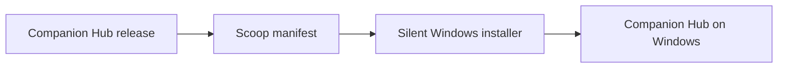

<h1 align="center">Companion Intelligence Scoop Bucket</h1>

<p align="center"><strong>Scoop bucket for Companion Intelligence desktop apps.</strong></p>

[](https://github.com/companionintelligence/Companion-Hub/releases/latest)
[](https://github.com/companionintelligence/scoop-bucket)
[](LICENSE.md)
[](https://discord.com/invite/yQp9hwpzAa)

<p align="center"><a href="#install-companion-hub-windows">Get started</a> · <a href="https://docs.ci.computer/docs/reference/open-source-systems">Systems map</a> · <a href="README.md#install-companion-hub-windows">Documentation</a></p>

<p align="center">
  <a href="#install-companion-hub-windows"></a>
</p>

## Features

| Feature | What it provides |
|---|---|
| **Windows install manifest** | Download the Hub installer and run the silent setup. |
| **Release tracking** | Follow GitHub Hub releases rather than building the app here. |
| **User data** | Preserve user data during Scoop upgrades and uninstall hooks. |

## How it fits together

The bucket tracks the Companion Hub installer release and delegates installation to the Windows setup program; the bucket preserves user data during upgrades.



## Install Companion Hub (Windows)

```powershell
scoop bucket add companionintelligence https://github.com/companionintelligence/scoop-bucket
scoop install companion-hub
```

## Update

```powershell
scoop update companion-hub
```

Manifests are generated from [CI-Hub `distribution/`](https://github.com/companionintelligence/CI-Hub/tree/dev/distribution) on each desktop release.

<!-- companion-hub-readme-deep-review -->

## Windows package behavior

| Item | Behavior |
|---|---|
| Platform | Windows x64 installer |
| Install | Scoop runs the Hub installer silently |
| Version source | Manifest checks Companion Hub GitHub releases |
| Upgrade and uninstall | User data is preserved; the uninstall hook removes only managed Docker containers and networks |

Scoop may run uninstall hooks during upgrades, so the manifest intentionally avoids deleting persistent application data. Back up Hub data using the Hub's own backup workflow before manually removing it.

